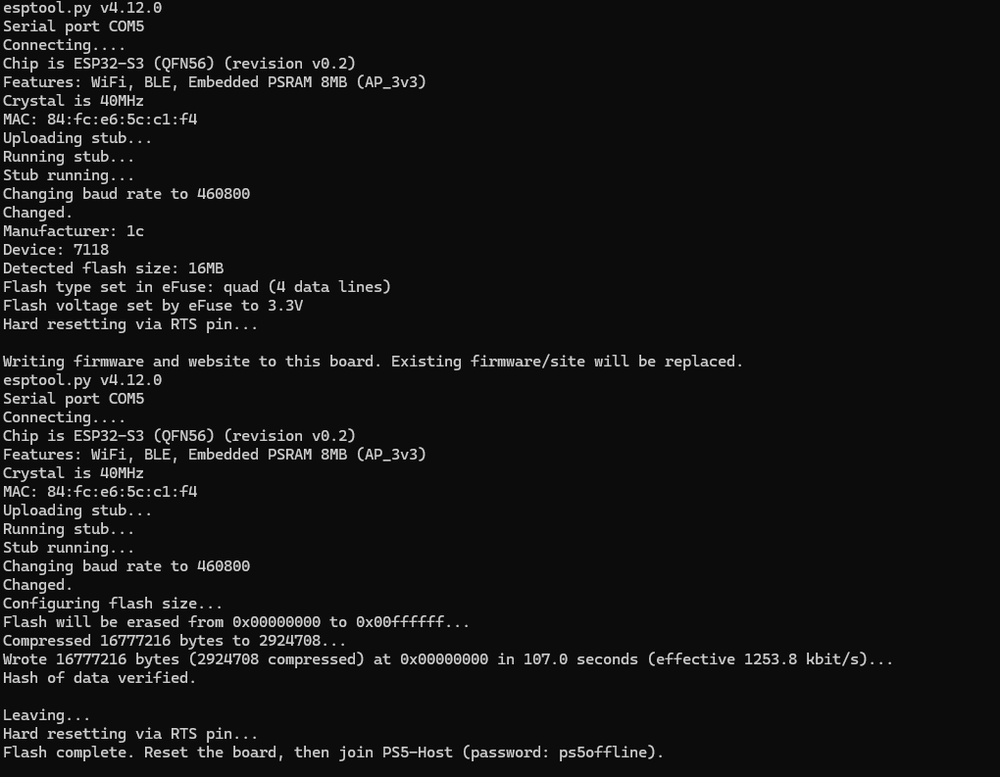

# PS5 ESP32 Host — Relapse Exploit

**Supported firmware: 7.00 through 13.60.**

A standalone Wi-Fi host for the **Relapse exploit**, built for the
**ESP32-S3-WROOM-1 N16R8 (16 MB flash, 8 MB octal PSRAM)**. The ESP32 serves the
exploit page and payload files; the exploit itself runs on the PS5.

## Download and flash

1. [Download the ready-to-flash ZIP](downloads/ps5-host-n16r8.zip) using GitHub's
   **Download raw file** button, then extract it on your Windows computer.
2. Install Python 3 if needed. Connect the board with a USB **data** cable,
   preferably through its UART connector.
3. Find the COM port in **Device Manager → Ports (COM & LPT)**.
4. Open PowerShell inside the extracted folder and run:

   ```powershell
   py -m pip install "esptool>=4.8,<5"
   py flash.py --port COM5
   ```

   Replace `COM5` with your port. The script checks the image checksum and
   detected 16 MB flash before replacing the board's firmware and web files.
5. After flashing, press **RESET** and keep the board powered by USB.

If connection fails, hold **BOOT**, tap **RESET**, release **BOOT**, then retry.
For transfer errors, run `py flash.py --port COM5 --baud 115200`.
Do not use this firmware on other ESP32 variants or different flash/PSRAM layouts.

## Successful flash



The supplied screenshot shows an ESP32-S3 with 8 MB PSRAM and 16 MB flash.
It wrote the complete 16,777,216-byte image at `0x00000000`, then reported
**Hash of data verified** and **Flash complete**. Your port and transfer time
may differ. This confirms a physical-board flash, not end-to-end PS5 testing.

## Connect the PS5

| Setting | Value |
| --- | --- |
| Wi-Fi network | `PS5-Host` |
| Password | `ps5offline` |
| IP address | Automatic |
| DHCP hostname | Do not specify |
| DNS | Automatic |
| MTU | Automatic |
| Proxy | Do not use |
| Host address | `192.168.4.1` |

Open **User's Guide** on the PS5. Proceed past the local certificate prompt if
one is offered. If automatic DNS does not work, use `192.168.4.1` as primary DNS.
The hotspot has no Internet connection, so an Internet/PSN test can fail while
local hosting works.

After the exploit starts the ELF loader, press **R2** to send:

1. `nanodns.elf`
2. `shadowmountplus.elf`
3. `kstuff.elf`

The firmware range describes Relapse support; individual payload compatibility
and exploit stability can vary. Hosting the page does not guarantee a successful
exploit run. Reload or reboot the console if the exploit stalls or crashes.

## What runs on the board

- WPA2 Wi-Fi access point with built-in DHCP for automatic IP configuration.
- Local DNS resolving `manuals.playstation.net` and `ps5.host` to the board.
- HTTP on port 80 and HTTPS on port 443, with User's Guide paths redirected to
  the local homepage.
- Read-only web files and ELF payloads stored in flash.

No Raspberry Pi, Docker, or computer web server is required after flashing.
There is no payload upload UI or over-the-air updater; changing the bundled
files requires rebuilding and reflashing.

## Troubleshooting and source build

From a computer joined to `PS5-Host`, open `http://192.168.4.1/status` or run:

```powershell
nslookup manuals.playstation.net 192.168.4.1
curl.exe -k https://192.168.4.1/
```

DNS should return `192.168.4.1`. If the hotspot is absent, press RESET without
holding BOOT and check USB power. Serial logs use the native USB Serial/JTAG
connection at 115200 baud.

See the [full flashing guide](firmware/esp32s3/FLASHING.md) and
[ESP-IDF source-build instructions](firmware/esp32s3/README.md).
Clone the whole repository to build; the firmware uses the root `src`, `offsets`
and `payloads` folders. The prebuilt ZIP contains its checksum and flashing script.

This repository packages the Relapse exploit for ESP32 hosting. Original project:
[ntfargo/Relapse-Exploit](https://github.com/ntfargo/Relapse-Exploit).
See [LICENSE](LICENSE).