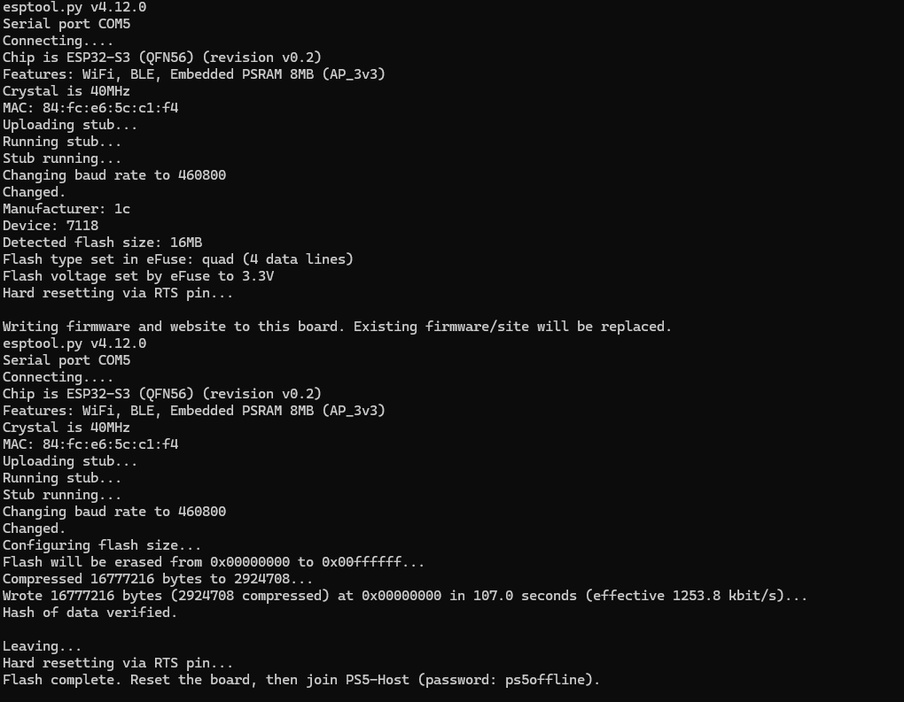

# Flash and connect

Target: ESP32-S3-WROOM-1 **N16R8** (16 MB QSPI flash, 8 MB octal PSRAM).
Do not use this image on an ESP8266, ordinary ESP32, C3, or S3 with a different
flash/PSRAM arrangement. This is a standalone offline host, not Linux.

## Program from Windows

1. Extract the release ZIP into a folder.
2. Install Python 3 if needed, then run `py -m pip install "esptool>=4.8,<5"`.
3. Connect the board with a USB **data** cable. The USB/UART connector generally
   provides reliable flashing; the native USB connector also supports the S3
   ROM downloader. Identify its COM port in Windows Device Manager.
4. From the extracted folder run `py flash.py --port COM5` using the actual port.
   The script checks the image hash and the board's 16 MB flash before writing.
   Flashing replaces the existing firmware and stored web files on that board.
5. If connection fails, hold **BOOT**, tap **RESET**, release **BOOT**, and retry.
   Try `--baud 115200` if transfer errors occur. Tap RESET after programming.

On Linux use `python3` and a port such as `/dev/ttyACM0` or `/dev/ttyUSB0`.
No erase-flash command or eFuse changes are required. A failed transfer can be
retried using the ROM downloader.

## Successful flash example

This user-provided screenshot shows an ESP32-S3 with 8 MB PSRAM and detected
16 MB flash on `COM5`. The complete 16,777,216-byte image was written at
`0x00000000`, followed by **Hash of data verified** and **Flash complete**.
Your COM port and transfer time may differ. This confirms programming and
verification on the board; it does not by itself verify Wi-Fi or PS5 execution.

After the final reset, allow the board to boot and look for `PS5-Host`. If it
does not appear, tap RESET once without holding BOOT. Keep USB power connected.

## Connect the PS5

- Wi-Fi network: **PS5-Host**
- Wi-Fi password: **ps5offline**
- IP address settings: **Automatic** (built-in DHCP)
- DHCP host name: do not specify
- DNS settings: **Automatic** (DHCP advertises 192.168.4.1)
- MTU: automatic; proxy: do not use
- Board address/gateway/DNS: **192.168.4.1**, subnet mask **255.255.255.0**

The DHCP server gives clients an address in the 192.168.4.0/24 subnet and a
two-hour lease. There is no upstream Internet connection; the PS5 Internet/PSN
test may fail even when the local host works. Open **User's Guide** in Settings.
Proceed through the self-signed certificate prompt if offered by your firmware.
The board serves HTTPS on 443, HTTP on 80, and redirects guide document paths to
the homepage. R2 sends **nanoDNS → ShadowMount Plus → kstuff**.

A computer on the same board Wi-Fi can check `http://192.168.4.1/status`.
`nslookup manuals.playstation.net 192.168.4.1` should return 192.168.4.1.
If the PS5 does not pick up DNS automatically, set primary DNS to 192.168.4.1.
This firmware answers ordinary UDP DNS A queries; known-name AAAA queries get
an empty answer and other names receive NXDOMAIN. It is not a general router.

The flash package embeds a local self-signed TLS key; it is not a secret shared
with an Internet service. A fresh source build generates a separate identity.
Connect only devices you trust to this Wi-Fi. Change its password in menuconfig
when building your own version.

The S3 firmware hosts files; it does not improve exploit stability or establish
payload/PS5 firmware compatibility. Physical-board and PS5 testing is still
required. USB power must remain on while serving files. The default log console
uses the native USB Serial/JTAG connection at 115200 baud.
