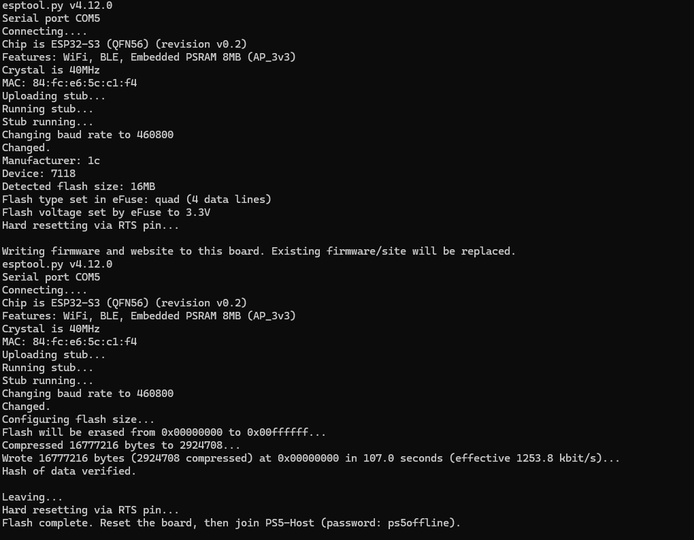

# ESP32-S3 offline PS5 host

An ESP-IDF **v5.4.2** project for the **ESP32-S3-WROOM-1 N16R8**.

- WPA2 2.4 GHz access point (PS5-Host / ps5offline), up to four clients.
- Built-in DHCP gives clients an IP, gateway, subnet mask, lease and local DNS.
- DNS maps manuals.playstation.net and ps5.host to 192.168.4.1.
- HTTP and HTTPS serve the same read-only SPIFFS site; guide paths redirect to /.
- Large ELF files are streamed in 8 KiB chunks, not loaded into board RAM whole.
- The existing PS5-side R2 flow runs nanoDNS, ShadowMount Plus, then kstuff.
- No upload manager, upstream connection, NAT, OTA, or Linux services.

See [FLASHING.md](FLASHING.md) for programming a release and connecting the PS5.

## Ready-to-flash firmware

Download `ps5-host-n16r8.zip` from this repository's `downloads` folder and
extract it on your Windows PC. Install Python 3, open PowerShell in the
extracted folder, and run:

```powershell
py -m pip install "esptool>=4.8,<5"
py flash.py --port COM5
```

Replace `COM5` with the board's port from Device Manager. Use a USB data cable.
The package contains the complete firmware and website; no Raspberry Pi,
Docker, or separate Python web server is needed while the board is running.
Only use this image on the ESP32-S3 N16R8 configuration described above.



The screenshot confirms a successful physical-board flash and data verification.
Wi-Fi, DHCP and PS5 execution should still be checked after boot using the
[connection and troubleshooting instructions](FLASHING.md).

## Build from source

Install the official [ESP-IDF v5.4.2 toolchain](https://docs.espressif.com/projects/esp-idf/en/v5.4.2/esp32s3/get-started/index.html).
Open its configured terminal (or source `export.sh` on Linux). Clone/copy the
**whole repository**, including payloads; this subdirectory is not standalone.

```bash
cd firmware/esp32s3
python tools/prepare.py
idf.py set-target esp32s3
idf.py menuconfig
idf.py build
python tools/package.py
```

Under **PS5 offline host**, optionally change SSID/password/channel in menuconfig.
The defaults configure 16 MB QIO flash and 8 MB octal PSRAM. `prepare.py` uses
the `cryptography` module supplied by the ESP-IDF Python environment to create
the TLS identity. It copies index.html, src, offsets, and these payloads:

- elfldr-ps5-1360.elf
- kexp_2026_05_25.bin
- nanodns.elf
- shadowmountplus.elf
- kstuff.elf

etaHEN is intentionally not packaged because the current R2 flow does not use it.
To change payloads later, change both the source R2 list and `PAYLOADS` in
tools/prepare.py, rerun prepare/build/package, and reflash. Generated site,
certificate keys, SDK config, build products and releases are Git-ignored.

The merged image and ZIP are written under `dist/`. Or flash directly from the
ESP-IDF terminal with `idf.py -p COM5 flash monitor`. The SPIFFS image is included
automatically. For an out-of-tree build, pass its directory to tools/package.py.

## Flash layout

| Partition | Offset | Size |
| --- | --- | --- |
| NVS | 0x9000 | 24 KiB |
| PHY | 0xf000 | 4 KiB |
| Application | 0x10000 | 3 MiB |
| Read-only site (SPIFFS) | 0x310000 | 12.94 MiB |

SPIFFS uses 128-byte filename fields for nested site paths. Staging rejects
missing payloads, invalid ELF magic and excessive total size. Mount errors stop
boot rather than formatting away the site. HTTP and HTTPS use different control
ports so they can run together. DHCP starts with the AP's network interface;
the serial log reports each assigned IP.

## Host checks

The DNS parser is independent C and can be tested without a board:

```bash
cc -std=c11 -Wall -Wextra -Werror main/dns.c tests/test_dns.c -I main -o /tmp/test-ps5-dns
/tmp/test-ps5-dns
```

After flashing, verify DHCP, DNS, HTTPS, complete ELF downloads and R2 on physical
hardware. A successful compiler build alone cannot verify Wi-Fi range, power,
TLS acceptance by a particular PS5 firmware or exploit success.
